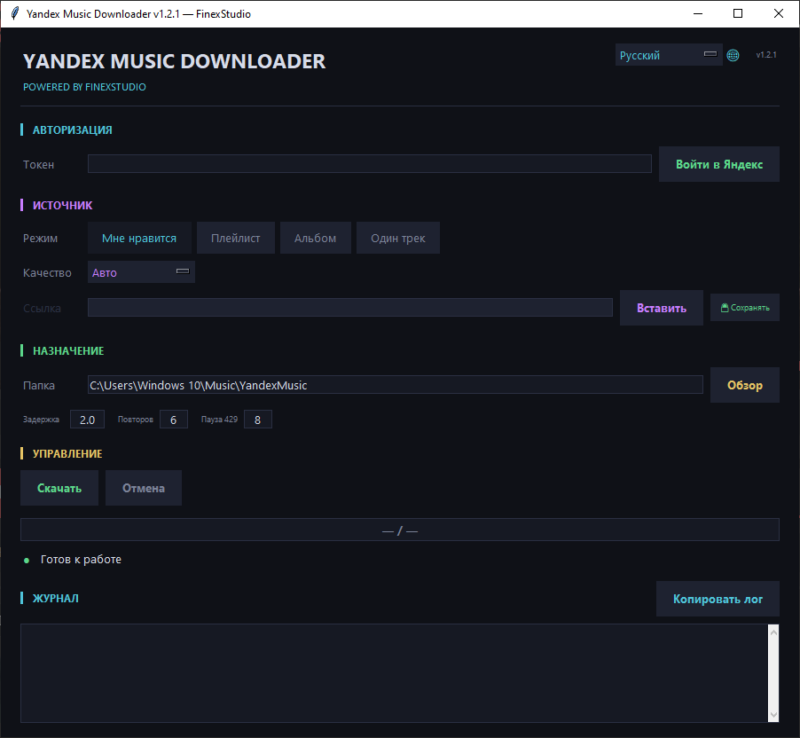
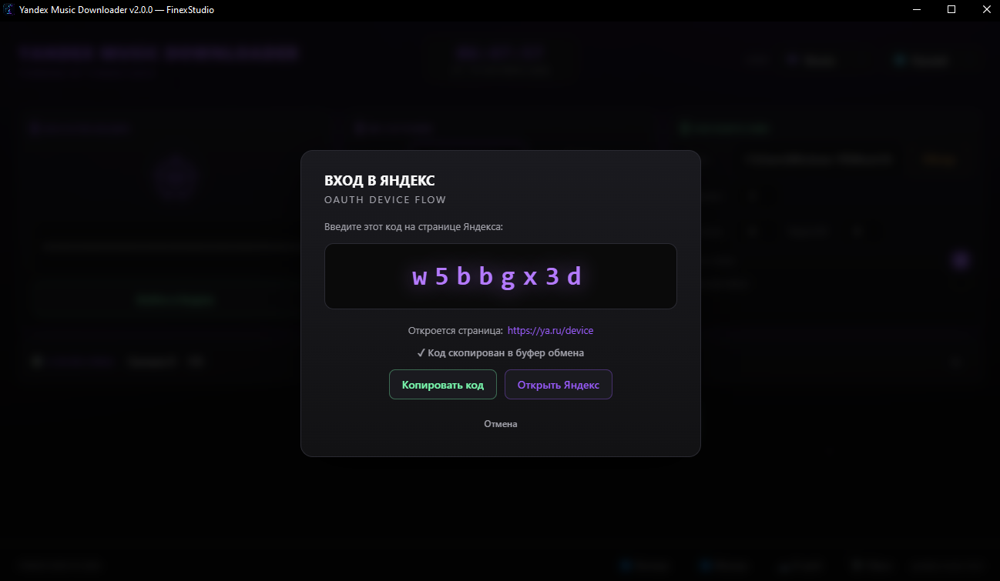
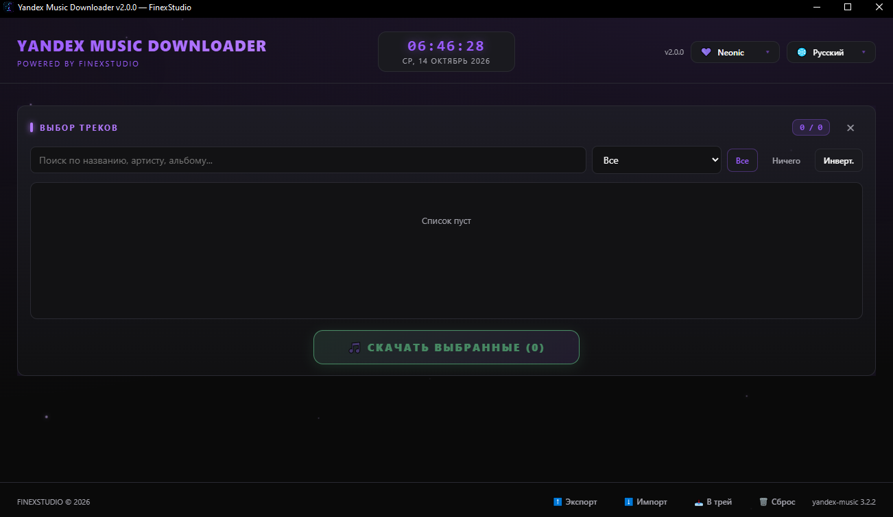
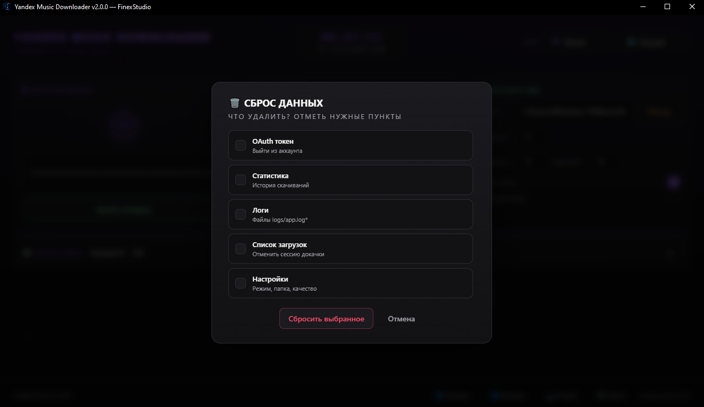

<div align="center">

# 🎵 Yandex Fuck Downloader

**Современный загрузчик музыки из Яндекс.Музыки с поддержкой плейлистов, альбомов и любимых треков**

[](https://github.com/finex975/YandexFuckDownload/releases)
[](https://github.com/finex975/YandexFuckDownload/releases)
[](https://www.python.org/)
[](LICENSE)

[**Скачать**](https://github.com/finex975/YandexFuckDownload/releases/latest) ·
[**Возможности**](#-возможности) ·
[**Скриншоты**](#-скриншоты) ·
[**Установка**](#-установка) ·
[**FAQ**](#-faq)

</div>

---

## 🎬 О проекте

**Yandex Music Downloader** — это приложение с современным интерфейсом для скачивания музыки из Яндекс.Музыки на ваш компьютер. Поддерживает плейлисты, альбомы, отдельные треки и раздел «Мне нравится». Автоматически вшивает обложки, метаданные и тексты песен.

> ⚡ **Один EXE-файл. Никаких зависимостей. Запустил — работает.**

---

## 📸 Скриншоты

<table>
  <tr>
    <td align="center" width="50%">
      <br/>
      <b>Главный экран — настройки источника, качества и папки</b>
    </td>
    <td align="center" width="50%">
      <br/>
      <b>Авторизация через OAuth Device Flow</b>
    </td>
  </tr>
  <tr>
    <td align="center" width="50%">
      <br/>
      <b>Превью плейлиста с выбором треков</b>
    </td>
    <td align="center" width="50%">
      <br/>
      <b>Гибкий сброс — выбери что удалить</b>
    </td>
  </tr>
  <tr>
    <td align="center" colspan="2">
      <br/>
      <b>Код копируется автоматически, браузер открывается сам</b>
    </td>
  </tr>
</table>

---

## ✨ Возможности

### 🎯 Скачивание
- **4 режима источника:** «Мне нравится», плейлист, альбом, отдельный трек
- **4 варианта качества:** Auto, MP3 320, MP3 192, FLAC
- **Параллельная загрузка** — 3 трека одновременно, до 5 потоков на метаданные
- **Докачка** — если загрузка прервалась, приложение подхватит с того же места
- **Пропуск дубликатов** — уже скачанные файлы не качаются повторно
- **Обход 429** — авто-retry с экспоненциальной задержкой (8 → 60 сек)
- **Устойчивость к сбоям** — недоступные треки (регион/подписка/удалён) не валят очередь

### 🎨 Интерфейс
- **9 тем оформления:** Dark, Sunset, Emerald, AMOLED, Light, Lunar Blue, Samurai Ink, Matte Black, Neonic
- **14 языков:** RU, EN, UK, BE, KK, UZ, TR, RO, DE, FR, IT, ZH, JA, KO
- **Виджет часов и календаря** с навигацией по месяцам
- **Плавные анимации** и адаптивная вёрстка
- **Живой прогресс** с оценкой оставшегося времени (ETA)

### 🎧 Метаданные
- **Вшивание обложек** в MP3 (ID3) и FLAC
- **Теги:** название, исполнитель, альбом, год, номер трека, жанр
- **Тексты песен** сохраняются рядом с аудио (`.lrc`)
- **Структура папок** `Artist / Album / NN - Title` (опционально)

### 🛠️ Управление
- **Пауза / продолжить** загрузку в один клик
- **Сворачивание в системный трей** с меню
- **Экспорт / импорт** настроек в JSON
- **Гибкий сброс данных** — по частям или всё сразу
- **Статистика** в SQLite: количество, размер, топ-артисты
- **Автопроверка** при старте: 10 пунктов + тост с результатом
- **Горячие клавиши:** `Ctrl+Enter`, `Ctrl+L`, `Ctrl+Shift+P`, `Ctrl+Shift+R`

### 🔐 Безопасность
- **Токен в системном keyring** — Windows Credential Manager, macOS Keychain, Linux SecretService
- **Fallback** — обфусцированный `token.dat` на случай отсутствия keyring
- **Правильное хранение** — данные в `%LOCALAPPDATA%`, а не рядом с exe

---

## 📥 Установка

### Windows

1. Скачай `YandexMusicDownloader.exe` из [**последнего релиза**](https://github.com/finex975/YandexFuckDownload/releases/latest)
2. Запусти файл — Windows SmartScreen может предупредить, нажми **«Подробнее» → «Выполнить в любом случае»**
3. Готово! Первый запуск ~3–7 секунд (распаковка)

> **Требования:** Windows 10/11 с установленным WebView2 Runtime (обычно уже есть)

### Linux

```bash
# Скачай архив из релиза и распакуй
unzip YandexMusicDownloader-Linux.zip
cd YandexMusicDownloader
./YandexMusicDownloader
```

> **Требования:** GTK 3, WebKitGTK 4.1

```bash
sudo apt install python3-gi python3-gi-cairo gir1.2-gtk-3.0 gir1.2-webkit2-4.1
```

### macOS

Скачай `YandexMusicDownloader.app` из релиза и перетащи в `Applications`.

---

## 🚀 Использование

### 1. Авторизация

Нажми **«Войти в Яндекс»** — откроется окно с кодом:

1. Код **автоматически копируется** в буфер обмена
2. Нажми **«Открыть Яндекс»** — браузер откроется на странице авторизации
3. Введи код и подтверди вход
4. Вернись в приложение — токен подхватится автоматически

### 2. Выбор источника

| Режим | Что скачает |
|---|---|
| **Мне нравится** | Все треки из раздела «Мне нравится» |
| **Плейлист** | Все треки из плейлиста по ссылке |
| **Альбом** | Все треки из альбома |
| **Один трек** | Один конкретный трек |

### 3. Настройки

- **Качество** — `Auto` (рекомендуется), `MP3 320`, `MP3 192`, `FLAC`
- **Папка** — куда сохранять файлы (по умолчанию `~/Music/YandexMusic`)
- **Задержка** — пауза между треками (по умолчанию 2 сек)
- **Повторов** — количество попыток при ошибке (по умолчанию 6)
- **Тексты песен** — сохранять `.lrc` рядом с аудио
- **Структура папок** — сортировка `Artist / Album / NN - Title`

### 4. Превью и запуск

- **«Загрузить список»** — покажет превью всех треков с поиском и фильтрами
- **«Скачать»** — начнёт загрузку всей очереди
- **«Скачать выбранные»** — только отмеченные в превью

---

## 🛠️ Сборка из исходников

### Требования
- Python 3.9+
- pip

### Windows

```cmd
git clone https://github.com/finex975/YandexFuckDownload.git
cd YandexFuckDownload
build.bat
```

### Linux / macOS

```bash
git clone https://github.com/finex975/YandexFuckDownload.git
cd YandexFuckDownload
chmod +x build.sh
./build.sh
```

### Ручная сборка

```bash
python -m venv .venv
source .venv/bin/activate  # Windows: .venv\Scripts\activate
pip install -r requirements.txt
pip install pyinstaller
pyinstaller --clean --noconfirm yandex_music_downloader.spec
```

Результат: `dist/YandexMusicDownloader.exe`

---

## 🧱 Технологии

| Компонент | Технология |
|---|---|
| **Backend** | Python 3.9+, [yandex-music](https://github.com/MarshalX/yandex-music-api) |
| **GUI** | [pywebview](https://pywebview.flowrl.com/) + HTML/CSS/JS |
| **Аудио** | [mutagen](https://mutagen.readthedocs.io/) — метаданные ID3/FLAC |
| **Обложки** | [Pillow](https://python-pillow.org/) |
| **Статистика** | SQLite |
| **Трей** | [pystray](https://github.com/moses-palmer/pystray) |
| **Токен** | [keyring](https://github.com/jaraco/keyring) |
| **Сборка** | [PyInstaller](https://pyinstaller.org/) |
| **CI/CD** | GitHub Actions |

---

## 📁 Структура проекта

```
YandexFuckDownload/
├── main.py                          # Точка входа
├── api.py                           # JS API (вызывается из UI)
├── paths.py                         # Системные пути (%LOCALAPPDATA%)
├── startup_check.py                 # Автопроверка при запуске
├── metadata_utils.py                # ID3/FLAC + обложки + тексты
├── secure_store.py                  # Хранение токена
├── history.py                       # История докачки
├── stats.py                         # SQLite-статистика
├── tray.py                          # Системный трей
├── notify.py                        # Уведомления ОС
├── log_setup.py                     # Логирование с ротацией
├── updater.py                       # Проверка обновлений
├── translations.py                  # 14 языков
├── web/                             # UI
│   ├── index.html
│   ├── style.css
│   └── app.js
├── yandex_music_downloader.spec     # PyInstaller spec
├── build.bat / build.sh             # Скрипты сборки
├── requirements.txt
└── .github/workflows/build.yml      # CI/CD
```

---

## 🌍 Локализация

Приложение переведено на **14 языков**:

🇷🇺 Русский · 🇬🇧 English · 🇺🇦 Українська · 🇧🇾 Беларуская · 🇰🇿 Қазақша · 🇺🇿 O'zbekcha · 🇹🇷 Türkçe · 🇷🇴 Română · 🇩🇪 Deutsch · 🇫🇷 Français · 🇮🇹 Italiano · 🇨🇳 中文 · 🇯🇵 日本語 · 🇰🇷 한국어

Хочешь добавить свой язык? Отредактируй `translations.py` и отправь PR.

---

## 🎨 Темы

| Тема | Описание |
|---|---|
| 🌙 **Dark** | Классическая тёмная (по умолчанию) |
| 🌅 **Sunset** | Тёплые оранжево-розовые оттенки |
| 🌲 **Emerald** | Изумрудная зелень |
| ⬛ **AMOLED** | Чистый чёрный для OLED-экранов |
| ☀️ **Light** | Светлая дневная |
| 🌌 **Lunar Blue** | Глубокий синий космос |
| 🎴 **Samurai Ink** | Японский минимализм |
| 🖤 **Matte Black** | Матовый чёрный |
| 💜 **Neonic** | Неоновый фиолетовый |

Тема переключается в один клик, сохраняется в настройках.

---

## ❓ FAQ

<details>
<summary><b>Где хранятся настройки и статистика?</b></summary>

- **Windows:** `%LOCALAPPDATA%\FinexStudio\YandexMusicDownloader\`
- **Linux:** `~/.local/share/YandexMusicDownloader/`
- **macOS:** `~/Library/Application Support/YandexMusicDownloader/`

Там же: `settings.json`, `history.json`, `stats.db`, `logs/`, `token.dat`

</details>

<details>
<summary><b>Почему Windows Defender ругается на EXE?</b></summary>

Стандартная проблема всех PyInstaller-сборок. Причина — отсутствие цифровой подписи. Код открыт, можешь проверить. Для запуска: **«Подробнее» → «Выполнить в любом случае»**.

</details>

<details>
<summary><b>Некоторые треки не скачиваются, что делать?</b></summary>

Скорее всего они недоступны через API Яндекса (региональная блокировка, нужна подписка Плюс, трек удалён). Открой трек в браузере — если серый, значит скачать не получится. Приложение покажет `⛔ Недоступен` и продолжит качать остальные.

</details>

<details>
<summary><b>Как войти по токену?</b></summary>

Нажми **«Войти в Яндекс»** и используй OAuth Device Flow. Вводить токен вручную не нужно — код показывается прямо в приложении.

</details>

<details>
<summary><b>Можно ли качать в FLAC?</b></summary>

Да, выбери `FLAC` в настройках качества. Учти: не все треки имеют FLAC-версию — для таких приложение автоматически упадёт на mp3.

</details>

<details>
<summary><b>Как сбросить все данные?</b></summary>

Кнопка **«🗑 Сброс»** в футере → отметь нужные пункты (токен, статистика, логи, история, настройки) → **«Сбросить выбранное»**.

</details>

<details>
<summary><b>Как перенести настройки на другой ПК?</b></summary>

Кнопка **«⬆ Экспорт»** — сохранит `settings.json`. На другом ПК нажми **«⬇ Импорт»** и выбери файл.

</details>

---

## 🤝 Contributing

Pull requests приветствуются! По крупным изменениям сначала открой issue для обсуждения.

**Полезные ссылки:**
- 🐛 [Сообщить о баге](https://github.com/finex975/YandexFuckDownload/issues/new?template=bug_report.md)
- 💡 [Предложить фичу](https://github.com/finex975/YandexFuckDownload/issues/new?template=feature_request.md)
- 🌍 [Добавить язык](https://github.com/finex975/YandexFuckDownload/blob/main/translations.py)

---

## ⚠️ Отказ от ответственности

Приложение предназначено **только для личного использования**. Скачивание контента из Яндекс.Музыки может нарушать их условия использования. Автор не несёт ответственности за любое использование этого ПО.

**Пожалуйста, поддерживайте артистов и покупайте подписку Яндекс.Плюс.**

---

## 📜 Лицензия

MIT License — см. [LICENSE](LICENSE)

---

## 🙏 Благодарности

- [**MarshalX**](https://github.com/MarshalX) — за [yandex-music](https://github.com/MarshalX/yandex-music-api)
- [**pywebview**](https://pywebview.flowrl.com/) — за кроссплатформенный WebView
- [**PyInstaller**](https://pyinstaller.org/) — за сборку EXE
- Всем, кто тестировал и присылал багрепорты

---

<div align="center">

**Made with 💜 by [FinexStudio](https://github.com/finex975)**

⭐ Поставь звезду, если проект оказался полезным!

</div>
