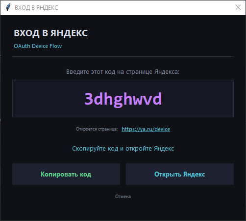
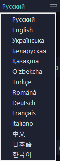
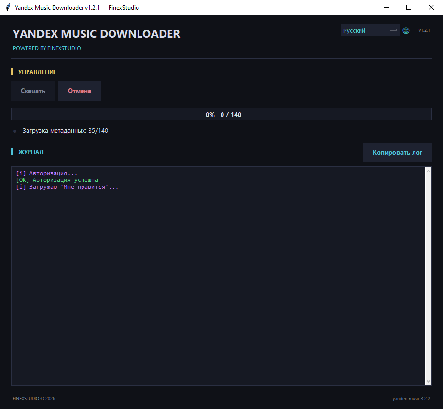

# YandexFuckDownloader

Скачивай свои любимые треки из Яндекс.Музыки на локальный ПК.

## Возможности

- Мне нравится - вся коллекция одной кнопкой
- Плейлисты - по ссылке
- Альбомы - целиком
- Отдельные треки - по ссылке /track/ID
- OAuth Device Flow - вход без ручного ввода токена
- Тёмный интерфейс в стиле cyber-neon
- Авто-retry при 429 - пережидает лимиты API
- Докачка - уже скачанные треки пропускаются

## Установка и запуск

Требуется Python 3.9+.

    git clone https://github.com/finex975/YandexFuckDownload/
    cd YandexFuckDownload
    python main.py

Скрипт сам установит зависимости при первом запуске.

## Как пользоваться

### Авторизация

1. Нажми Войти в Яндекс
2. Скопируй код кнопкой Копировать
3. Браузер откроется сам - вставь код на странице Яндекса
4. Токен подставится автоматически

### Режимы

| Режим | Что вводить |
|-------|-------------|
| Мне нравится | ничего |
| Плейлист | https://music.yandex.ru/users/USER/playlists/ID |
| Альбом | https://music.yandex.ru/album/ID |
| Один трек | https://music.yandex.ru/track/ID |

### Папка сохранения
## 📸 Скриншоты

### Главное окно

### Авторизация через OAuth Device Flow

<table>
<tr>
<td width="50%">

<i>1. Код показывается в приложении</i>

</td>
<td width="50%">

<i>2. Вводится на странице Яндекса</i>

</td>
</tr>
</table>

### 14 языков интерфейса

### Скачивание в процессе

По умолчанию: C:/Users/Имя/Music/YandexMusic/

## Ограничения

- 429 Concurrency limit - Яндекс ограничивает частоту запросов. Скрипт пережидает автоматически.
- Только личное использование - распространение треков нарушает авторские права.
- Неофициальный API - возможны перебои при изменениях на стороне Яндекса.

## Технологии

- Python 3.9+, Tkinter
- yandex-music (https://github.com/MarshalX/yandex-music-api)
- requests

## Поддержать разработчика

https://ko-fi.com/finex_studio

## Лицензия

MIT. Made by FinexStudio.
