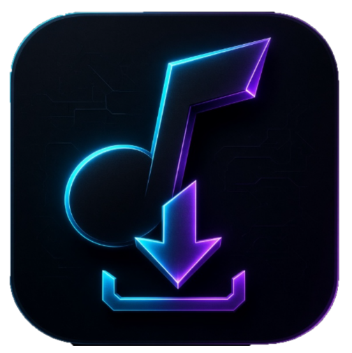

<div align="center">



# Yandex Fuck Downloader

**Скачивай свои любимые треки из Яндекс.Музыки на локальный ПК**

[](https://www.python.org/)
[](#)
[](LICENSE)
[](https://github.com/finex975/YandexFuckDownload/releases)

[](https://github.com/finex975/YandexFuckDownload/releases)
[](https://ko-fi.com/finex_studio)

</div>

---

## ✨ Возможности

<table>
<tr>
<td width="50%" valign="top">

### 🎵 Скачивание

- **🎧 Мне нравится** — вся коллекция лайков одной кнопкой
- **📀 Плейлисты** — по ссылке на публичный плейлист
- **💿 Альбомы** — целиком, со всеми треками
- **🎼 Один трек** — по ссылке вида `/track/12345`

### 🎚 Качество звука

- **Auto** — оптимальное доступное
- **MP3 320 kbps** — высокое
- **MP3 192 kbps** — стандартное
- **FLAC** — lossless

</td>
<td width="50%" valign="top">

### 🔐 Авторизация

- **OAuth Device Flow** — вход через браузер
- Без ручного копирования токенов
- Токен сохраняется автоматически

### 🎨 Интерфейс

- Тёмная тема с неоновыми акцентами
- **14 языков** — от русского до корейского
- Плавные анимации, кастомный прогресс-бар

### ⚙️ Умное скачивание

- **Авто-retry** при лимитах Яндекса
- **Докачка** — уже скачанное пропускается
- **Автоустановка** зависимостей при первом запуске
- Логирование в `app.log`

</td>
</tr>
</table>

---

## 📸 Скриншоты

<div align="center">

### Главное окно


### Авторизация через OAuth Device Flow

<table>
<tr>
<td width="50%">

<p align="center"><sub>1. Код показывается в приложении</sub></p>
</td>
<td width="50%">

<p align="center"><sub>2. Вводится на странице Яндекса</sub></p>
</td>
</tr>
</table>

### 14 языков интерфейса


### Скачивание в процессе


</div>

---

## 🚀 Быстрый старт

### Вариант 1 — Готовый `.exe` (рекомендуется)

1. Скачай последний релиз: [**Releases**](https://github.com/finex975/YandexFuckDownload/releases)
2. Запусти `YandexFuckDownload.exe`
3. Готово

> [!NOTE]
> **Windows SmartScreen** может показать предупреждение — это нормально для приложений без платной цифровой подписи.
> Нажми **«Подробнее»** → **«Выполнить в любом случае»**.

### Вариант 2 — Из исходников

**Требуется:** Python 3.9+ | Windows / Linux / macOS

```bash
git clone https://github.com/finex975/YandexFuckDownload.git
cd YandexFuckDownload
python main.py
```

При первом запуске скрипт **сам установит зависимости** — `yandex-music` и `requests`.

---

## 📖 Как пользоваться

### 1. Авторизация

<table>
<tr><td width="30"><b>1.</b></td><td>Нажми <b>🚀 Войти в Яндекс</b></td></tr>
<tr><td><b>2.</b></td><td>В открывшемся окне скопируй код кнопкой <b>📋 Копировать код</b></td></tr>
<tr><td><b>3.</b></td><td>Браузер откроется сам — вставь код на странице Яндекса</td></tr>
<tr><td><b>4.</b></td><td>Токен подставится автоматически, авторизация завершена</td></tr>
</table>

### 2. Выбор источника

| Режим | Что вводить |
|:------|:------------|
| **🎧 Мне нравится** | Ничего — вся коллекция лайков |
| **📀 Плейлист** | `https://music.yandex.ru/users/USER/playlists/ID` |
| **💿 Альбом** | `https://music.yandex.ru/album/ID` |
| **🎼 Один трек** | `https://music.yandex.ru/track/ID` |

### 3. Папка сохранения

По умолчанию: `C:\Users\Имя\Music\YandexMusic\`

Каждый плейлист — в **отдельной подпапке** со своим названием.

---

## ⚠️ Ограничения

> [!WARNING]
> **Только личное использование.** Распространение скачанных треков нарушает авторские права и правила сервиса Яндекс.Музыки.

- **429 Concurrency limit** — Яндекс ограничивает частоту запросов. Программа сама пережидает лимит (экспоненциальная задержка 8 → 60 секунд с джиттером).
- **Неофициальный API** — при изменениях на стороне Яндекса возможны перебои в работе.

---

## 🛠️ Технологии

<div align="center">


</div>

- **Python 3.9+** — язык разработки
- **Tkinter** — нативный GUI без внешних зависимостей
- [**yandex-music**](https://github.com/MarshalX/yandex-music-api) — неофициальная библиотека API Яндекс.Музыки
- **requests** — HTTP-запросы

---

## 🗺️ Планы развития

- [x] Скачивание «Мне нравится», плейлистов, альбомов, треков
- [x] OAuth Device Flow
- [x] 14 языков интерфейса
- [x] Выбор качества MP3 / FLAC
- [x] Автопроверка обновлений
- [ ] Вшивание обложек и метаданных в MP3
- [ ] Прогресс-бар с ETA
- [ ] Цифровая подпись `.exe` (SignPath Foundation)
- [ ] Сборка `.exe` через GitHub Actions

---

## ☕ Поддержать разработчика

<div align="center">

Если программа оказалась полезной — можешь угостить меня кофе.

<a href="https://ko-fi.com/finex_studio">

</a>

</div>

---

## 📄 Лицензия

Распространяется под лицензией **MIT**. См. [LICENSE](LICENSE) для подробностей.

**Музыка принадлежит её правообладателям.** Программа предоставляет только инструмент для скачивания в личных целях.

---

<div align="center">

**Made with ❤️ by [FinexStudio](https://github.com/finex975)**

<sub>© 2026 FinexStudio. Не связан с Яндекс.Музыкой.</sub>

</div>
